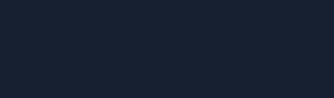

# Laporan Hasil Uji Keamanan

**Klasifikasi:** RAHASIA / CONFIDENTIAL

| | |
|---|---|
| Dibuat | 2026-11-19 (contoh) |
| Disusun oleh | Security Audit Kit — dibuat oleh hadymaggot · https://github.com/hadymaggot/security-audit-kit |
| Target | Contoh Aplikasi (demo) (https://dev.contoh.example) |
| Versi dokumen | 1.0 |

## 1. Ringkasan Eksekutif

Pengujian menemukan 6 instance temuan (1 Critical, 3 High, 1 Medium, 1 Low) yang tergolong dalam 6 jenis alert. Temuan berisiko tertinggi: Kontrol akses rusak (role rendah membuka area terbatas); SQL Injection (A03); Web server versi rentan (CVE diketahui). Perbaikan disarankan memprioritaskan temuan Critical dan High terlebih dahulu. Rincian teknis, bukti endpoint, dan rekomendasi tersedia pada bagian Rincian Temuan.

| Severity | Jumlah instance |
|---|---|
| 🔴 Critical | 1 |
| 🟠 High | 3 |
| 🟡 Medium | 1 |
| 🔵 Low | 1 |
| ⚪ Info | 0 |
| 🟢 PASS (kontrol lolos) | 2 |

Total alert: **6** · Total CVE: **1**.

## 2. Ruang Lingkup & Metodologi

- **Target:** Contoh Aplikasi (demo) (https://dev.contoh.example).
- **Modul/teknik yang dijalankan:** authz-matrix, cors, headers, injection, recon, webstack.
- **Metodologi:** Pengujian dijalankan secara otomatis dan non-destruktif terhadap target yang berwenang diuji. Acuannya OWASP Top 10 2021, OWASP ASVS, dan OWASP Risk Rating Methodology (severity = Likelihood x Impact). Tooling yang digunakan OWASP ZAP, Trivy, dan testssl.sh, ditambah rangkaian regression test untuk access control, upload, dan password policy.

## 3. Ringkasan Risiko

| ID | Alert | Risiko | CVSS v3.1 | Keyakinan | Instance |
|---|---|---|---|---|---|
| SAK-001 | Kontrol akses rusak (role rendah membuka area terbatas) | 🔴 CRITICAL | 9.1 | Tinggi | 1 |
| SAK-002 | SQL Injection (A03) | 🟠 HIGH | 9.8 | Tinggi | 1 |
| SAK-003 | Web server versi rentan (CVE diketahui) | 🟠 HIGH | 7.5 | Tinggi | 1 |
| SAK-004 | Kredensial/secret bocor di source/aset | 🟠 HIGH | 8.6 | Tinggi | 1 |
| SAK-005 | CORS salah konfigurasi | 🟡 MEDIUM | 6.5 | Tinggi | 1 |
| SAK-006 | Header keamanan tidak diset | 🔵 LOW | 3.7 | Tinggi | 1 |

## 4. Rincian Temuan

### SAK-001 — 🔴 Kontrol akses rusak (role rendah membuka area terbatas)

- **Severity:** CRITICAL &nbsp; **CVSS v3.1 (indikatif):** 9.1 — CVSS:3.1/AV:N/AC:L/PR:L/UI:N/S:C/C:H/I:H/A:N &nbsp; **Keyakinan:** Tinggi &nbsp; **Status:** Terbuka
- **Sumber/plugin:** authz-matrix (`broken-access`)
- **Deskripsi:** Endpoint sensitif dapat diakses oleh role yang tidak berwenang karena otorisasi tidak ditegakkan di sisi server.
- **Instance yang diuji (1):**

  | # | Endpoint diuji | Konteks | HTTP | Bukti |
  |---|---|---|---|---|
  | 1 | `GET https://dev.contoh.example/api/admin/users` | GET /api/admin/users | 200 | Role 'user' menerima HTTP 200 pada endpoint khusus admin — otorisasi tidak ditegakkan di server.  |

- **CVE/CWE:** -
- **Dampak:** Peningkatan hak akses (privilege escalation), pembuatan/penghapusan akun, perubahan data kritikal — berpotensi pengambilalihan sistem.
- **Justifikasi severity:** Likelihood tinggi (dapat dipicu oleh pengguna login biasa tanpa alat khusus) x Impact tinggi (kendali penuh fungsi admin).
- **Rekomendasi & contoh solusi:**
  - Tegakkan otorisasi di SISI SERVER pada setiap endpoint, bukan hanya menyembunyikan menu di klien.
  - Terapkan authorization middleware/guard sebelum handler, contoh pola:

  ```
      // middleware: tolak jika role tak termasuk daftar yang diizinkan
      if (!user.roles.intersects(endpoint.allowedRoles)) return deny(403);
  ```

  - Gunakan RBAC/ABAC terpusat; jadikan 'default deny' sebagai perilaku bawaan.
- **Referensi:** OWASP A01:2021 Broken Access Control; OWASP ASVS V4 Access Control; BSSN Perban No.4/2021 Pasal 26 huruf c (persyaratan kontrol akses)

### SAK-002 — 🟠 SQL Injection (A03)

- **Severity:** HIGH &nbsp; **CVSS v3.1 (indikatif):** 9.8 — CVSS:3.1/AV:N/AC:L/PR:N/UI:N/S:U/C:H/I:H/A:H &nbsp; **Keyakinan:** Tinggi &nbsp; **Status:** Terbuka
- **Sumber/plugin:** injection (`sql-injection`)
- **Deskripsi:** Input pengguna disusun langsung ke query SQL tanpa parameterisasi, sehingga penyerang dapat mengubah logika query (error-based, boolean-based, atau time-based).
- **Instance yang diuji (1):**

  | # | Endpoint diuji | Konteks | HTTP | Bukti |
  |---|---|---|---|---|
  | 1 | `GET https://dev.contoh.example/api/produk?id=1` | Parameter 'id' rentan SQL Injection (boolean-based) | 200 | Respons berbeda antara id=1 AND 1=1 dan id=1 AND 1=2 — indikasi SQLi. |

- **CVE/CWE:** -
- **Dampak:** Pembacaan/perubahan data di luar wewenang, bypass autentikasi, hingga potensi RCE tergantung konfigurasi DBMS.
- **Justifikasi severity:** Likelihood sedang–tinggi (vektor klasik, tooling melimpah) x Impact tinggi (kerahasiaan & integritas data). Deteksi otomatis wajib diverifikasi manual sebelum severity final dikunci.
- **Rekomendasi & contoh solusi:**
  - Gunakan prepared statement / parameterized query (bind parameter), jangan merangkai string query dari input.

  ```
      // Laravel: Model::where('x', $input) / DB::select('... = ?', [$input])
      // JANGAN DB::raw("... = '$input'").
  ```

  - Terapkan allowlist tipe/format input dan least-privilege pada akun DB.
  - Pakai ORM/query builder dengan benar; hindari raw query berisi input mentah.
- **Referensi:** OWASP A03:2021 Injection; CWE-89 SQL Injection; OWASP Testing Guide WSTG-INPV-05

### SAK-003 — 🟠 Web server versi rentan (CVE diketahui)

- **Severity:** HIGH &nbsp; **CVSS v3.1 (indikatif):** 7.5 — CVSS:3.1/AV:N/AC:L/PR:N/UI:N/S:U/C:H/I:N/A:N &nbsp; **Keyakinan:** Tinggi &nbsp; **Status:** Terbuka
- **Sumber/plugin:** webstack (`server-vuln`)
- **Deskripsi:** Versi web server/komponen yang terdeteksi dari banner cocok dengan kerentanan yang telah terdaftar (CVE), mis. Apache mod_http2 atau NGINX HTTP/2.
- **Instance yang diuji (1):**

  | # | Endpoint diuji | Konteks | HTTP | Bukti |
  |---|---|---|---|---|
  | 1 | `GET https://dev.contoh.example/` | Versi rentan: nginx 1.18.0 | 200 | Banner Server mengekspos versi dengan CVE diketahui. |

- **CVE/CWE:** CVE-2026-123633
- **Dampak:** Bergantung CVE-nya, berpotensi remote code execution, DoS, atau memory corruption pada server yang terekspos.
- **Justifikasi severity:** Likelihood sedang (eksploit publik untuk CVE yang aktif) x Impact tinggi (RCE/DoS). Deteksi berbasis banner — keyakinan sedang, wajib dikonfirmasi ke advisory vendor.
- **Rekomendasi & contoh solusi:**
  - Update ke versi yang sudah diperbaiki sesuai advisory vendor (mis. Apache httpd 2.4.71+, NGINX 1.30.7+/1.31.9+).
  - Batasi exposure komponen yang rentan; terapkan mitigasi sementara (mis. WAF, nonaktifkan modul/fitur terkait bila memungkinkan).
  - Kosongkan banner versi (ServerTokens Prod / server_tokens off) agar tidak memudahkan fingerprint.
- **Referensi:** OWASP A06:2021 Vulnerable and Outdated Components; CISA Known Exploited Vulnerabilities (KEV)

### SAK-004 — 🟠 Kredensial/secret bocor di source/aset

- **Severity:** HIGH &nbsp; **CVSS v3.1 (indikatif):** 8.6 — CVSS:3.1/AV:N/AC:L/PR:N/UI:N/S:C/C:H/I:L/A:N &nbsp; **Keyakinan:** Tinggi &nbsp; **Status:** Terbuka
- **Sumber/plugin:** recon (`leaked-secret`)
- **Deskripsi:** Kredensial/secret (API key, token, password) terdeteksi di source atau aset (trufflehog), berpotensi ter-commit ke repository.
- **Instance yang diuji (1):**

  | # | Endpoint diuji | Konteks | HTTP | Bukti |
  |---|---|---|---|---|
  | 1 | `app/config/prod.py` | secret: AWS Access Key | - | terverifikasi di app/config/prod.py — kredensial ter-commit ke repository. |

- **CVE/CWE:** -
- **Dampak:** Secret yang bocor dapat dipakai menyalahgunakan layanan pihak ketiga, mengakses data, atau pivot ke sistem internal.
- **Justifikasi severity:** Likelihood tinggi (mudah ditemukan via scanner otomatis) x Impact tinggi (akses langsung ke layanan/data). Terverifikasi = High.
- **Rekomendasi & contoh solusi:**
  - Cabut (revoke) dan rotasi segera secret yang bocor; anggap sudah terkompromi.
  - Hapus secret dari riwayat git (git filter-repo/BFG), bukan hanya commit terbaru.
  - Pindahkan secret ke environment variable / secret manager; jangan commit ke repo.
  - Pasang pre-commit hook (gitleaks/trufflehog) untuk mencegah kebocoran berulang.
- **Referensi:** OWASP A07:2021 Identification and Authentication Failures; CWE-798 Use of Hard-coded Credentials; OWASP ASVS V2.10

### SAK-005 — 🟡 CORS salah konfigurasi

- **Severity:** MEDIUM &nbsp; **CVSS v3.1 (indikatif):** 6.5 — CVSS:3.1/AV:N/AC:L/PR:N/UI:R/S:U/C:H/I:N/A:N &nbsp; **Keyakinan:** Tinggi &nbsp; **Status:** Terbuka
- **Sumber/plugin:** cors (`cors-misconfig`)
- **Deskripsi:** Konfigurasi CORS terlalu longgar: server memantulkan Origin apa pun ke Access-Control-Allow-Origin, atau memadukan wildcard dengan Access-Control-Allow-Credentials, atau menerima Origin 'null'.
- **Instance yang diuji (1):**

  | # | Endpoint diuji | Konteks | HTTP | Bukti |
  |---|---|---|---|---|
  | 1 | `GET https://dev.contoh.example/api/profil` | ACAO merefleksikan Origin + ACAC: true | 200 | CORS mengizinkan kredensial lintas-origin arbitrer. |

- **CVE/CWE:** -
- **Dampak:** Situs jahat yang dibuka korban bisa mengirim request berkredensial ke API dan membaca responsnya — pencurian data terautentikasi lintas-origin.
- **Justifikasi severity:** Likelihood sedang (butuh korban buka situs jahat sambil login) x Impact tinggi (baca data terautentikasi).
- **Rekomendasi & contoh solusi:**
  - Jangan pantulkan Origin mentah. Pakai allowlist origin yang tepercaya saja.
  - Contoh (pola backend):

  ```
      if (allowlist.includes(origin)) resp.header('Access-Control-Allow-Origin', origin);
  ```

  - Kalau butuh Access-Control-Allow-Credentials: true, Origin WAJIB spesifik, bukan '*' dan bukan hasil pantulan sembarangan.
  - Tolak Origin 'null'. Batasi method & header yang diizinkan seperlunya.
- **Referensi:** OWASP A05:2021 Security Misconfiguration; OWASP ASVS V14 Configuration; BSSN Perban No.4/2021 huruf h (keamanan komunikasi)

### SAK-006 — 🔵 Header keamanan tidak diset

- **Severity:** LOW &nbsp; **CVSS v3.1 (indikatif):** 3.7 — CVSS:3.1/AV:N/AC:H/PR:N/UI:N/S:U/C:L/I:N/A:N &nbsp; **Keyakinan:** Tinggi &nbsp; **Status:** Terbuka
- **Sumber/plugin:** headers (`missing-header`)
- **Deskripsi:** Security header respons tidak dikonfigurasi (atau header pembocor info seperti Server/X-Powered-By masih tampil).
- **Instance yang diuji (1):**

  | # | Endpoint diuji | Konteks | HTTP | Bukti |
  |---|---|---|---|---|
  | 1 | `GET https://dev.contoh.example/` | Content-Security-Policy tidak diset | 200 | Header CSP tidak ada — mitigasi XSS berkurang. |

- **CVE/CWE:** -
- **Dampak:** Memudahkan clickjacking, MIME sniffing, XSS, dan fingerprinting server.
- **Justifikasi severity:** Likelihood rendah–sedang x Impact rendah (umumnya enabler, bukan celah tunggal).
- **Rekomendasi & contoh solusi:**
  - Set header di reverse proxy/framework:

  ```
      Strict-Transport-Security: max-age=31536000; includeSubDomains
      Content-Security-Policy: default-src 'self'
      X-Content-Type-Options: nosniff
      X-Frame-Options: DENY
      Referrer-Policy: strict-origin-when-cross-origin
  ```

  - Kosongkan/hapus header Server dan X-Powered-By.
- **Referensi:** OWASP A05:2021 Security Misconfiguration; OWASP Secure Headers Project

### Kontrol yang Lolos (PASS: 2)

Pemeriksaan yang diuji dan berperilaku benar (bukan temuan) — bukti cakupan uji.

| Pemeriksaan | Modul | Endpoint diuji | HTTP |
|---|---|---|---|
| GET /api/admin/users (role admin) | authz-matrix | `GET https://dev.contoh.example/api/admin/users` | 200 |
| Strict-Transport-Security diset | headers | `GET https://dev.contoh.example/` | 200 |

## 5. Daftar CVE

| CVE | Paket/Lokasi | Severity |
|---|---|---|
| CVE-2026-123633 | Versi rentan: nginx 1.18.0 | 🟠 HIGH |

## 6. Lampiran

**Tooling & acuan.** OWASP ZAP (DAST); Trivy (SCA/CVE); semgrep (SAST); gitleaks (secret); testssl.sh (TLS); runner internal Security Audit Kit (authz, mass-assignment, upload, auth-policy, client-leak, cors, open-redirect, webstack, injection). Acuan: OWASP Top 10 2021, OWASP API Security Top 10 2023, OWASP ASVS, OWASP Risk Rating Methodology.

**Catatan CVSS.** Skor CVSS bersifat indikatif (pemetaan kualitatif dari OWASP Risk Rating + vektor v3.1 representatif per jenis temuan); skor+vektor final tetap perlu diverifikasi manual per konteks target.

**Batasan & pertanggungjawaban.** Laporan ini merupakan hasil automation, bukan pengganti pentest manual. Temuan scanner (misalnya ZAP) dapat berupa false positive dan wajib diverifikasi sebelum severity final ditetapkan. Celah logika bisnis hanya terdeteksi apabila test-nya ditulis secara khusus. Cakupan pengujian terbatas pada target dan endpoint yang dikonfigurasi saat dijalankan. Uji destruktif (mis. mass-assignment) menulis ke target lalu DIPULIHKAN otomatis ke keadaan semula sebagai fase terakhir setelah laporan ini dibuat; log pemulihan ada di reports/rollback.json, dan `python audit.py rollback` memulihkan ulang bila perlu.

---

_Security Audit Kit — dibuat oleh hadymaggot · https://github.com/hadymaggot/security-audit-kit_
